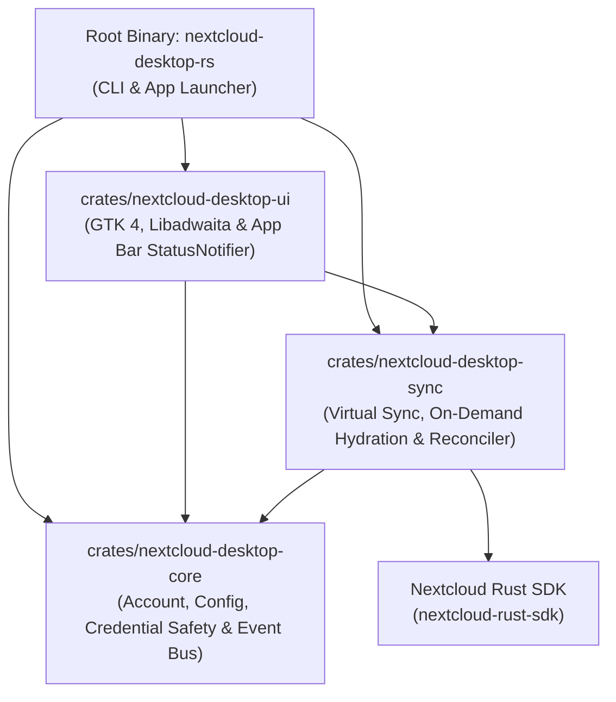

# Architecture Overview

`nextcloud-desktop-rs` is a high-integrity, modular desktop client for Nextcloud built in Rust (Edition 2024) and GTK 4, powered by the Nextcloud Rust SDK ([`nextcloud-rust-sdk`](https://github.com/Luxuride/nextcloud-rust-sdk)).

---

## 1. Architectural Philosophy

The repository strictly enforces separation of concerns across a Cargo workspace. Business logic, synchronization protocols, data models, and user interface layers are partitioned so that no single crate carries unrelated responsibilities:

---

## 2. Workspace Crate Boundaries

### `crates/nextcloud-desktop-core`
- **Purpose**: Domain models, persistent user configuration, credentials, and application-wide event dispatch.
- **Key Modules**:
  - `account.rs`: Connection profiles, server URLs, and credential secrets with custom `fmt::Debug` / `fmt::Display` redaction (`[REDACTED]`).
  - `config.rs`: Storage and deserialization of `AppConfig` (`~/.config/nextcloud-desktop-rs/config.json`).
  - `events.rs`: Thread-safe broadcast channel (`EventBus`) emitting transfer progress, sync lifecycle, and hydration events.
  - `error.rs`: Typed error enumeration with source preservation (`#[source]`).

### `crates/nextcloud-desktop-sync`
- **Purpose**: Virtual filesystem hierarchy maintenance, on-demand hydration, two-way local folder reconciliation, and WebDAV file operations.
- **Key Modules**:
  - `vfs.rs`: `VirtualSyncEngine` managing metadata placeholders and on-demand file hydration.
  - `full_sync.rs`: `FullSyncEngine` coordinating two-way local disk synchronization.
  - `scanner.rs`: Recursive local disk scanner and remote WebDAV `PROPFIND` traversal.
  - `reconciler.rs`: Deterministic state machine comparing local, remote, and journal states to produce `SyncAction` items.
  - `journal.rs`: Persistent `SyncJournal` tracking ETags, mtime, and file sizes.
  - `file_ops.rs`: High-level WebDAV operations: `PUT`, `GET`, `MKCOL`, `DELETE`, `MOVE`, and `COPY`.
  - `engine.rs`: Unified `DesktopSyncCoordinator` orchestrating background operations.

### `crates/nextcloud-desktop-ui`
- **Purpose**: GTK 4 desktop user interface and system tray app bar daemon.
- **Key Modules**:
  - `gtk_app.rs`: Main window, sidebar navigation stack, breadcrumb path navigator, and virtual file table.
  - `tray.rs`: FreeDesktop StatusNotifierItem (`ksni`) running the app bar indicator in the background.
  - `controller.rs`: Async controller bridging user input to background Tokio workers.
  - `model.rs`: Presentation state models and human-readable formatting.

### Root Binary (`src/main.rs`)
- Parses CLI arguments (`clap`), initializes structured tracing, loads configuration, and launches either the GTK 4 interface or the headless daemon.

---

## 3. Concurrency and Async Runtime Model

- The application uses **Tokio** as its primary asynchronous runtime for network I/O, WebDAV requests, and file transfers.
- Communication between Tokio background tasks and the GTK GLib main context is decoupled using thread-safe channels (`tokio::sync::mpsc`) and the `EventBus` broadcast channel.
- GUI event handling dispatches async tasks onto the local GLib context via `glib::MainContext::default().spawn_local`.

---

## 4. Credential Confidentiality Invariant

Passwords, session tokens, and authentication secrets must never appear in log files, terminal outputs, crash reports, or debug formatters. All types wrapping authentication secrets (`AccountCredentials`, `BasicAuth`) redact secret payloads as `[REDACTED]`.
