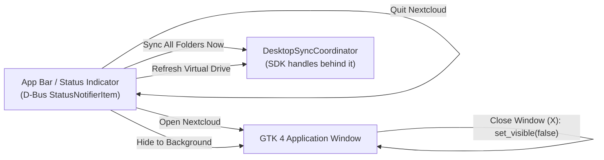

# Background Service & App Bar Status Notifier

`nextcloud-desktop-rs` is built to run continuously: transfers and virtual-drive
hydration must keep working after the window is closed, and the application must
be reachable from the desktop's app bar. This document covers that lifecycle —
the `ksni` StatusNotifierItem, the window-hide behaviour, and the headless and
one-shot CLI paths.

Everything described here is app-side presentation and process lifecycle. The
work being kept alive (mounts, sync cycles, hydration) belongs to
[`nextcloud-rust-sdk`](https://github.com/Luxuride/nextcloud-rust-sdk); see
[`ARCHITECTURE.md`](ARCHITECTURE.md).

---

## 1. App Bar (StatusNotifierItem) integration

The app bar icon is a FreeDesktop **StatusNotifierItem** served over D-Bus by
[`ksni`](https://crates.io/crates/ksni) — no deprecated C tray libraries, no
XEmbed. It is behind the `tray` feature (enabled by `default = ["desktop"]`,
Linux only).

This gives working status icons on:

- **GNOME Shell** (with AppIndicator / KStatusNotifierItem Support extensions)
- **KDE Plasma**
- **XFCE / MATE / Cinnamon**
- **Sway / Waybar / Polybar**



`spawn_app_bar_tray(tx_tray)` is called once, inside `build_ui`
(`crates/nextcloud-desktop-ui/src/desktop/gtk_app.rs:253-254`), before any page is
constructed.

The tray item owns a status string (initialised to `"In Sync"`) and forwards
user intent as `TrayAction::{ShowWindow, HideWindow, TriggerSync, RefreshVfs,
Quit}` (`crates/nextcloud-desktop-ui/src/desktop/tray.rs:11-22`) over an
`UnboundedSender`; a `glib::MainContext::default().spawn_local` loop
(`gtk_app.rs:383-408`) owns them and drives the controller. The tray never talks
to the SDK directly.

Two details worth knowing when extending the menu: `ShowWindow` calls
`set_visible(true)` **and** `present()` (the latter is what raises and focuses an
already-visible window), and `RefreshVfs` calls `refresh_for_tray()` — a GTK-side
rebuild callback — after `refresh_virtual_tree()`, so a tray refresh repaints the
file view immediately instead of waiting for the debounced `DesktopEvent` path.

The status text is **static in practice**. `DesktopTrayItem::set_syncing(syncing,
status_text)` exists (`tray.rs:43-47`) and `icon_name()` switches between
`view-refresh-symbolic` and `folder-remote-symbolic` on `self.syncing`, but
`set_syncing` has **no callers** — so the icon stays `folder-remote-symbolic` and
the tooltip description stays `"In Sync"` even mid-transfer. Wiring it up means
calling `set_syncing` from the `DesktopEvent` subscriber and requesting a D-Bus
property update.

---

## 2. Window minimisation and background lifespan

Closing the GTK 4 window (the `X` button) does **not** terminate the process:

- The window intercepts `close-request`, sets visibility to `false` and returns
  `glib::Propagation::Stop` (`gtk_app.rs:373-377`), so GTK's default
  "destroy the window" handler never runs and the process keeps its runtime.
- The Tokio runtime, the SDK orchestrator thread, hydration and app bar indicator
  stay fully active.
- **Open Nextcloud** on the tray restores and raises the window.
- **Quit Nextcloud** shuts the process down cleanly.

Because the coordinator outlives the window, an in-flight hydrate, download or
sync cycle is not interrupted by hiding the UI — it finishes and its
`DesktopEvent`s are simply delivered while nothing is visible.

---

## 3. Starting directly in the background

```sh
# Start hidden; only the app bar icon appears
cargo run -- --background
cargo run -- -b
```

`--background` becomes the `start_minimized` argument of
`launch_gtk_application(controller, start_minimized)`
(`crates/nextcloud-desktop-ui/src/desktop/gtk_app.rs:42-45`), which is threaded
down to `build_ui` and used exactly once, at the end:

```rust
if !start_minimized {
    window.present();
}
```

So `--background` means "build everything, register the tray, render the first
frame, but never call `present()`". Nothing else differs: the `present()` guard is
`gtk_app.rs:465-467`, and the initial `refresh_virtual_tree()` +
`sync_all_mounts()` kick-off (`gtk_app.rs:469-476`) is spawned either way.

`--background` is *not* read from `AppConfig.global.start_minimized` — the CLI
flag is the only input, and the config field is persisted but unread. Autostart
registration writes `Exec=<current exe>` with no `--background` argument
(`crates/nextcloud-desktop-core/src/autostart.rs:64-79`, the `Exec={exe_str}` line of
the `[Desktop Entry]` template, `X-GNOME-Autostart-enabled=true`), so a login
session actually starts **with** the window presented. There is no flag plumbing
to change that from the app: append `--background` to the `Exec=` line of the
generated `.desktop` file by hand, and it survives until the next
`register_autostart()` call overwrites the file — which happens on **every**
start, so the edit is lost each launch.

---

## 4. App bar menu

| Item | Effect |
| --- | --- |
| **Open Nextcloud** | Shows and raises the main window. |
| **Hide to Background** | Hides the window without stopping any work. |
| **Sync All Folders Now** | Triggers an immediate two-way cycle on every enabled pair via `controller.trigger_sync()`. |
| **Refresh Virtual Drive** | Re-crawls a virtual mount's metadata tree via `controller.refresh_virtual_tree()`. |
| **Quit Nextcloud** | Unmounts any FUSE session (`controller.unmount_fuse_vfs()`), calls `app.quit()`, then `std::process::exit(0)` (`gtk_app.rs:400-405`) — the hard exit is what guarantees the D-Bus tray service and the orchestrator thread do not outlive the UI, since `app.quit()` alone only ends the GLib main loop. |

---

## 5. Headless and one-shot CLI modes

The root binary (`src/main.rs`) parses `clap` flags and, when any of the
following is present, runs the requested operations and exits **without starting
GTK**:

| Flag | Action |
| --- | --- |
| `--headless` | Long-running daemon; waits for `SIGINT`/`Ctrl+C` and does nothing else itself. The 5 s remote-etag poller and the filesystem watcher were already started by the coordinator constructor, so it does keep detecting remote and local changes. |
| `--sync` | Runs one `trigger_sync()` cycle and exits. |
| `--refresh-vfs` | Re-crawls the virtual tree once. |
| `--hydrate <PATH>` / `--dehydrate <PATH>` | Hydrates or dehydrates a single path. |
| `--pause-sync` / `--resume-sync` | Pauses or resumes all mounts. |
| `--list-mounts` | Prints configured mounts, then active orchestrator mounts with status. |
| `--mount-vfs [DIR]` | FUSE-mounts the virtual filesystem (default mountpoint from `controller.default_fuse_mountpoint()`), blocking until `Ctrl+C`, then unmounts. |
| `--set-mount-mode <MOUNT_ID> <MODE>` | Persists a mount's sync mode. |
| `--config <PATH>` | Uses an alternative config path instead of the default. |

Clap derives kebab-case long names from the Rust field names (`--pause-sync`
from `pause_sync`). All flags live in `CliArgs` in `src/main.rs`; adding one means
adding a branch to the same `if` chain that decides between the CLI path and the
GTK path.

Two behaviours of that chain are easy to be surprised by:

- **The flags compose.** They are independent `if` blocks, not a `match`, so
  `--refresh-vfs --sync` does both, in the order listed above (`pause`/`resume`,
  `list-mounts`, `refresh-vfs`, `hydrate`, `dehydrate`, `sync`,
  `set-mount-mode`, `mount-vfs`), then falls through to the `--headless` wait.
- **Failures are logged, not propagated.** Each operation logs
  `tracing::error!` and continues, so the process still exits `0` after a failed
  `--sync`. Shell scripts cannot use the exit status as a success signal; watch
  the log instead (default filter `info`, override with `RUST_LOG`).

The `--headless` guard excludes itself when `--sync`, `--refresh-vfs`,
`--hydrate`, `--dehydrate`, `--mount-vfs` or `--set-mount-mode` was given, but
*not* when `--list-mounts`, `--pause-sync` or `--resume-sync` was given — so
`--headless --list-mounts` lists and then waits for `Ctrl+C`.

No display server is needed for any row above. Logging goes through
`tracing-subscriber`, filtered by `RUST_LOG` and defaulting to `info`.

If the binary is compiled without the `gtk` feature, even the interactive path
degrades to `run_headless(controller)` rather than failing.
