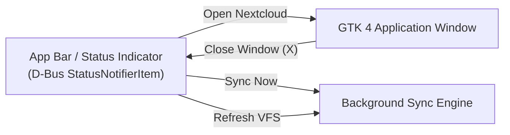

# Background Service & App Bar Status Notifier

Nextcloud Desktop is designed to run continuously in the background, keeping synchronized folders updated and providing quick access via the desktop App Bar (System Tray).

---

## 1. App Bar (StatusNotifierItem) Integration

The desktop app integrates with the FreeDesktop **StatusNotifierItem (SNI)** / AppIndicator protocol through [`ksni`](https://crates.io/crates/ksni), running purely over D-Bus without relying on deprecated external C tray libraries.

This provides out-of-the-box support for:
- **GNOME Shell** (with AppIndicator / KStatusNotifierItem extension)
- **KDE Plasma**
- **XFCE / MATE / Cinnamon**
- **Sway / Waybar / Polybar**



---

## 2. Window Minimization & Background Lifespan

Closing the GTK 4 window (e.g. clicking the `X` button) does **not** terminate the application:
- The window intercepts the `close-request` signal and sets visibility to `false`.
- The background Tokio event loop, periodic sync timers, and app bar indicator remain fully active.
- Clicking the tray icon or selecting **"Open Nextcloud"** restores and raises the window.
- Selecting **"Quit Nextcloud"** from the app bar menu cleanly terminates the background process.

---

## 3. Starting Directly in Background

To launch Nextcloud Desktop minimized into the app bar on startup:

```sh
# Start directly in the background
cargo run -- --background
# Or short flag:
cargo run -- -b
```

When started with `--background`, the GTK window remains hidden and only the app bar icon is displayed, ready for user interaction.

---

## 4. App Bar Context Menu Options

The App Bar menu provides immediate controls:

- **Open Nextcloud**: Displays the main GTK application window.
- **Sync All Folders Now**: Triggers an immediate bidirectional synchronization cycle across all configured folder pairings.
- **Refresh Virtual Drive**: Queries Nextcloud WebDAV via `PROPFIND` and refreshes the metadata placeholder hierarchy.
- **Quit Nextcloud**: Completely shuts down the application and background daemon.

---

## 5. Headless Daemon Mode

For headless servers, containers, or environments without a desktop display server (X11/Wayland), Nextcloud Desktop can run purely as a headless synchronization daemon:

```sh
cargo run -- --headless
```

The daemon listens for termination signals (`SIGINT` / `Ctrl+C`) and handles background synchronization according to `sync_interval_secs`.
