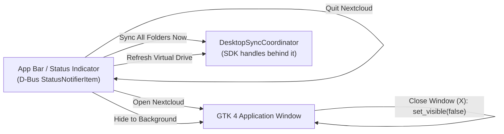

# Background Service & App Bar Status Notifier

`nexia-client` is built to run continuously: transfers and virtual-drive
hydration must keep working after the window is closed, and the application must
be reachable from the desktop's app bar. This document covers that lifecycle —
the `ksni` StatusNotifierItem, the window-hide behaviour, and the headless and
one-shot CLI paths.

Everything described here is app-side presentation and process lifecycle. The
work being kept alive (mounts, sync cycles, hydration) belongs to
[`nexia-nextcloud-sdk`](https://github.com/Luxuride/nexia-nextcloud-sdk); see
[`ARCHITECTURE.md`](ARCHITECTURE.md).

---

## 1. App Bar (StatusNotifierItem) integration

The app bar icon is a FreeDesktop **StatusNotifierItem** served over D-Bus by
[`ksni`](https://crates.io/crates/ksni) — no deprecated C tray libraries, no
XEmbed. It is behind the `tray` feature (enabled by `default = ["desktop"]`,
Linux only).

This gives working status icons on:

- **GNOME Shell** (with AppIndicator / KStatusNotifierItem Support extensions)
- **KDE Plasma**
- **XFCE / MATE / Cinnamon**
- **Sway / Waybar / Polybar**



`spawn_app_bar_tray(tx_tray)` is called once, inside `build_ui`, before any page
is constructed. It returns a `TrayAvailability` handle that the window consults
before it hides itself (see §2).

The tray item owns a status string (initialised to `"In Sync"`) and forwards
user intent as `TrayAction::{ShowWindow, HideWindow, TriggerSync, RefreshVfs,
Quit}` over an `UnboundedSender`; a `glib::MainContext::default().spawn_local`
loop owns them and drives the controller. The tray never talks to the SDK
directly.

Two details worth knowing when extending the menu: `ShowWindow` calls
`set_visible(true)` **and** `present()` (the latter is what raises and focuses an
already-visible window), and `RefreshVfs` calls `refresh_for_tray()` — a GTK-side
rebuild callback — after `refresh_virtual_tree()`, so a tray refresh repaints the
file view immediately instead of waiting for the debounced `DesktopEvent` path.

The status text is **static in practice**. `DesktopTrayItem::set_syncing(syncing,
status_text)` exists and `icon_name()` switches between `view-refresh-symbolic`
and `folder-remote-symbolic` on `self.syncing`, but `set_syncing` has **no
callers** — so the icon stays `folder-remote-symbolic` and the tooltip
description stays `"In Sync"` even mid-transfer. Wiring it up means calling
`set_syncing` from the `DesktopEvent` subscriber and requesting a D-Bus property
update.

### Sandboxed (Flatpak) operation

The item is spawned through a `TrayServiceBuilder`:

```rust
let builder = tray
    .assume_sni_available(true)
    .disable_dbus_name(sandboxed);
```

Both options exist for sandboxes:

- `disable_dbus_name(true)` under `nexia_core::is_flatpak()` skips the
  `RequestName` call for `org.kde.StatusNotifierItem-<pid>-<n>`. A Flatpak
  sandbox rejects that name with `org.freedesktop.DBus.Error.ServiceUnknown`
  unless the exact instance name is in `--own-name`, which cannot be known ahead
  of time. The item is then registered under its connection's unique name
  (`:1.x`), which needs no policy. GNOME's AppIndicator extension accepts that
  form through `BUS_ADDRESS_REGEX`; KDE Plasma accepts it too.
- `assume_sni_available(true)` turns a missing `org.kde.StatusNotifierWatcher`
  into a soft error routed to `Tray::watcher_offline`, so a tray-less session
  does not kill the service. `DesktopTrayItem` flips `TrayAvailability` to
  offline there and back to online from `watcher_online`.

`TrayAvailability` is a `watch` channel behind an `AtomicBool`, not a bare flag:
`set()` publishes every transition, so consumers can either read the current
state (`is_registered()`), wait for the first answer
(`wait_until_settled()`), or follow the stream (`subscribe()`). `unavailable()`
gives the non-Linux and no-`tray` builds a permanently offline value so the
window guard degrades to "always show" instead of "never settle".

Even with the unique name, `org.kde.StatusNotifierWatcher` must be reachable, so
the Flatpak manifest grants `--talk-name=org.kde.StatusNotifierWatcher`
(`flatpak/eu.luxuride.nexia.yml`). Every other Flathub app with a tray
icon grants the same permission; without it the whole registration is refused by
the sandbox before the watcher is ever contacted, which is exactly the
`D-Bus connection error: … ServiceUnknown` seen in the journal.

---

## 2. Window minimisation and background lifespan

Closing the GTK 4 window (the `X` button) does **not** terminate the process:

- The window intercepts `close-request`, sets visibility to `false` and returns
  `glib::Propagation::Stop`, so GTK's default "destroy the window" handler never
  runs and the process keeps its runtime.
- The hide only happens while `TrayAvailability::is_registered()` is `true`. With
  no reachable indicator the handler returns `glib::Propagation::Proceed`, letting
  GTK destroy the window so the process exits instead of lingering invisibly.
- When the process was started with `--background` and no indicator is
  registered, `build_ui` presents the window after evaluating the guard — an
  invisible, unreachable process is never the result.
- The guard is reactive as well: `TrayAvailability::subscribe()` streams every
  state change, and a `spawn_local` watcher restores a hidden window when an
  indicator that had been working goes away. Losing the app bar mid-session
  therefore cannot strand the process either.
- The Tokio runtime, the SDK orchestrator thread, hydration and app bar indicator
  stay fully active.
- **Open Nextcloud** on the tray restores and raises the window.
- **Quit Nextcloud** shuts the process down cleanly.

Because the coordinator outlives the window, an in-flight hydrate, download or
sync cycle is not interrupted by hiding the UI — it finishes and its
`DesktopEvent`s are simply delivered while nothing is visible.

---

## 3. Starting directly in the background

```sh
# Start hidden; only the app bar icon appears
cargo run -- --background
cargo run -- -b
```

`--background` becomes the `start_minimized` argument of
`launch_gtk_application(controller, start_minimized)`, which is threaded down to
`build_ui` and used once, at the end:

```rust
if start_minimized {
    // The tray service settles on a runtime task, so without waiting the
    // window could hide before its indicator is known to exist.
    glib::MainContext::default().spawn_local(async move {
        tray_availability.wait_until_settled().await;
        if tray_availability.is_registered() {
            tracing::info!("Starting in the background behind the app bar indicator");
        } else {
            tracing::warn!(
                "Starting in the background without an app bar indicator; showing the window"
            );
            window_for_settle.present();
        }
    });
} else {
    window.present();
}
```

The wait is not decoration: `spawn_app_bar_tray` registers on a Tokio task, so
reading `is_registered()` synchronously at this point would race the spawn and
could hide the window just before the registration failure arrives.
`wait_until_settled` resolves on the first settled state, and the fallback runs
only after the answer is known.

So `--background` means "build everything, register the tray, render the first
frame, but never call `present()`". Nothing else differs: the `present()` guard
behaves the same way, and the initial `refresh_virtual_tree()` +
`sync_all_mounts()` kick-off is spawned either way.

`--background` is *not* read from `AppConfig.global.start_minimized` — the CLI
flag is the only input, and the config field is persisted but unread.

Autostart registration always passes `--background` through `autostart_exec_line`
in the autostart module, so a login session starts with the window hidden behind
the app bar indicator:

| Environment | Generated `Exec=` | File written |
| --- | --- | --- |
| Native | `/abs/path/to/nexia-client --background` | `$XDG_CONFIG_HOME/autostart/eu.luxuride.nexia.desktop` |
| Flatpak | `flatpak run eu.luxuride.nexia --background` | `$HOME/.config/autostart/eu.luxuride.nexia.desktop` |

Two details make the Flatpak row work. The sandbox sets `XDG_CONFIG_HOME` to
`~/.var/app/eu.luxuride.nexia/config`, which the **host** session
never reads, so `autostart_config_dir()` writes to `$HOME/.config` instead — the
manifest's `--filesystem=xdg-config/autostart:create` makes that path writable.
And `flatpak run …` is used rather than `/app/bin/nexia-client`, which
does not exist outside the sandbox. The entry carries `X-Flatpak=<app id>` so
portals and desktop shells recognise it as a Flatpak app.

`register_autostart()` runs on every interactive start, so the file is rewritten
each launch and manual edits to it do not survive. One-shot CLI operations
(`--sync`, `--hydrate`, `--list-mounts`, the pause/resume switches, …) refresh
nothing: they must not rewrite the login behaviour of the desktop session they
were launched from.

---

## 4. App bar menu

| Item | Effect |
| --- | --- |
| **Open Nextcloud** | Shows and raises the main window. |
| **Hide to Background** | Hides the window without stopping any work. |
| **Sync All Folders Now** | Triggers an immediate two-way cycle on every enabled pair via `controller.trigger_sync()`. |
| **Refresh Virtual Drive** | Re-crawls a virtual mount's metadata tree via `controller.refresh_virtual_tree()`. |
| **Quit Nextcloud** | Unmounts any FUSE session (`controller.unmount_fuse_vfs()`), calls `app.quit()`, then `std::process::exit(0)` — the hard exit is what guarantees the D-Bus tray service and the orchestrator thread do not outlive the UI, since `app.quit()` alone only ends the GLib main loop. |

---

## 5. Headless and one-shot CLI modes

The launcher parses `clap` flags and, when any of the
following is present, runs the requested operations and exits **without starting
GTK**:

| Flag | Action |
| --- | --- |
| `--headless` | Long-running daemon; waits for `SIGINT`/`Ctrl+C` and does nothing else itself. The 5 s remote-etag poller and the filesystem watcher were already started by the coordinator constructor, so it does keep detecting remote and local changes. |
| `--sync` | Runs one `trigger_sync()` cycle and exits. |
| `--refresh-vfs` | Re-crawls the virtual tree once. |
| `--hydrate <PATH>` / `--dehydrate <PATH>` | Hydrates or dehydrates a single path. |
| `--pause-sync` / `--resume-sync` | Pauses or resumes all mounts. |
| `--list-mounts` | Prints configured mounts, then active orchestrator mounts with status. |
| `--mount-vfs [DIR]` | FUSE-mounts the virtual filesystem (default mountpoint from `controller.default_fuse_mountpoint()`), blocking until `Ctrl+C`, then unmounts. |
| `--set-mount-mode <MOUNT_ID> <MODE>` | Persists a mount's sync mode. |
| `--config <PATH>` | Uses an alternative config path instead of the default. |

Clap derives kebab-case long names from the Rust field names (`--pause-sync`
from `pause_sync`). All flags live in `CliArgs` in the CLI argument parser;
adding one means adding a branch to the same `if` chain that decides between the
CLI path and the GTK path.

Two behaviours of that chain are easy to be surprised by:

- **The flags compose.** They are independent `if` blocks, not a `match`, so
  `--refresh-vfs --sync` does both, in the order listed above (`pause`/`resume`,
  `list-mounts`, `refresh-vfs`, `hydrate`, `dehydrate`, `sync`,
  `set-mount-mode`, `mount-vfs`), then falls through to the `--headless` wait.
- **Failures are logged and reported through the exit status.** Each operation
  logs `tracing::error!`, keeps going with the remaining operations, and records
  itself in a failure list; `main` returns `Err` when that list is non-empty, so
  the process exits non-zero and prints
  `<n> requested operation(s) failed: <operation>: <error>; …`. A `--sync` that
  fails is therefore visible to cron, a systemd unit or a shell chain, and a
  partial success reports the operations that failed rather than only the log.

The `--headless` guard excludes itself whenever any one-shot action was given —
`--sync`, `--refresh-vfs`, `--hydrate`, `--dehydrate`, `--list-mounts`,
`--pause-sync`, `--resume-sync`, `--mount-vfs` or `--set-mount-mode` — so
`--headless --list-mounts` lists and exits. `--headless` alone (or with
`--background` and `--config` only) is the daemon that waits for `Ctrl+C`;
`--mount-vfs` blocks on its own mountpoint instead.

No display server is needed for any row above. Logging goes through
`tracing-subscriber`, filtered by `RUST_LOG` and defaulting to `info`.

If the binary is compiled without the `gtk` feature, even the interactive path
degrades to `run_headless(controller)` rather than failing. That runner is a
daemon too: it mounts what the CLI asked for, then waits for `Ctrl+C` and
unmounts, so a `--no-default-features` build keeps the watcher and the etag
poller alive exactly like `--headless`.
