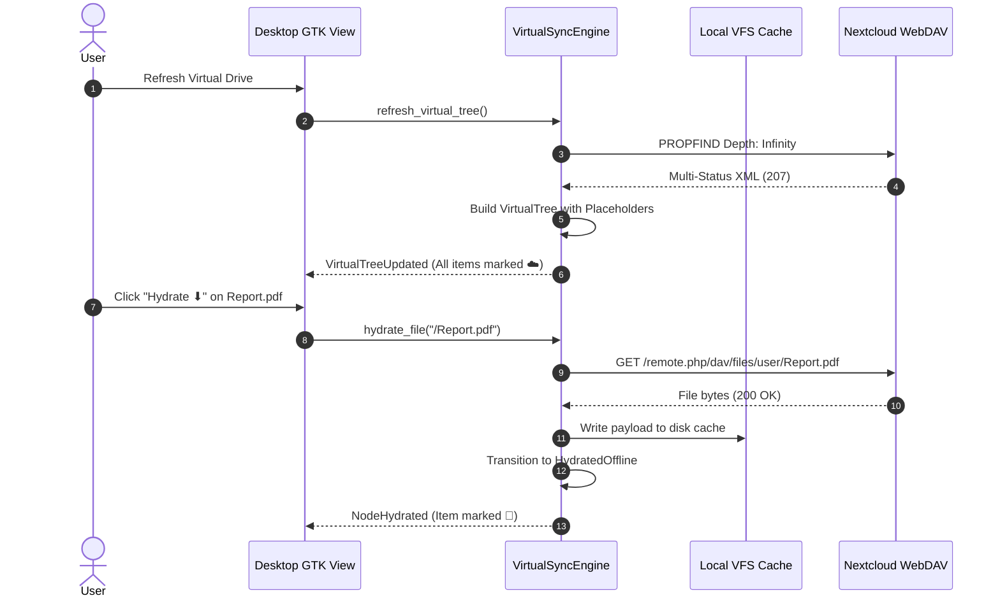

# Virtual Synchronization & On-Demand Hydration

Nextcloud Desktop features a **Virtual Sync Engine** designed to provide instant access to entire remote cloud hierarchies without downloading file contents upfront or wasting local storage space.

---

## 1. How Virtual Sync Works

Unlike traditional sync engines that eagerly download every byte to disk, Virtual Sync decouples file metadata from file content:



---

## 2. Hydration States

Each virtual node in [`nextcloud-sdk-vfs`] has an explicit hydration state:

| State | Status Badge | Disk Footprint | Backing Storage |
| :--- | :--- | :--- | :--- |
| **`Placeholder`** | ☁️ Virtual (Cloud Only) | 0 bytes | None (Metadata-only record) |
| **`Hydrated`** | 💾 Offline Ready | Full file size | Local cache file on disk (`~/.cache/nextcloud-desktop/vfs/...`) |

---

## 3. On-Demand Hydration

When a user requests to open, preview, or make a virtual file available offline:
1. `VirtualSyncEngine::hydrate_file` checks whether the target file has already been cached on disk.
2. If already hydrated and valid, the local file path is returned immediately.
3. If still a placeholder, a WebDAV `GET` request is issued to Nextcloud.
4. The downloaded bytes are safely written to the local cache directory preserving folder hierarchy.
5. The virtual node in `VirtualTree` is updated from `HydrationState::Placeholder` to `HydrationState::Hydrated(HydratedContent::Path(cached_path))`.
6. An event `DesktopEvent::NodeHydrated` is emitted to notify the UI and status bar.

---

## 4. Dehydration & Space Reclamation

To conserve local storage, users can dehydrate files when local copies are no longer needed offline:
1. `VirtualSyncEngine::dehydrate_file` is invoked for the target path.
2. The cached payload on disk is deleted.
3. The virtual node state reverts to `HydrationState::Placeholder`.
4. File metadata (size, mime type, last modified date, ETag) is preserved so the file remains visible in the browser with 0 bytes consumed on disk.
5. A `DesktopEvent::NodeDehydrated` event is broadcast.

---

## 5. Command Line Virtual Sync Operations

The CLI provides direct access to virtual sync operations:

```sh
# Refresh the remote virtual file hierarchy
cargo run -- --refresh-vfs

# Hydrate an individual file on-demand
cargo run -- --hydrate /Documents/Presentation.pdf

# Dehydrate a file back to a placeholder
cargo run -- --dehydrate /Documents/Presentation.pdf
```
