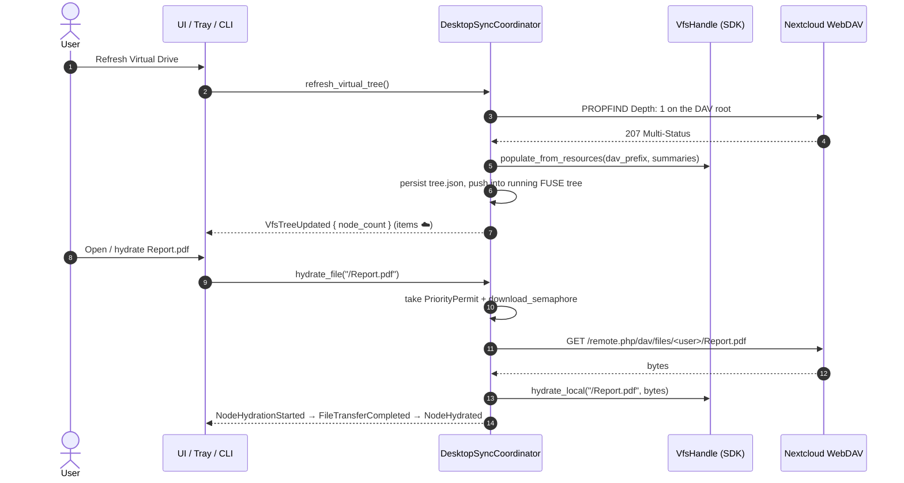

# Virtual Synchronisation & On-Demand Hydration

Virtual sync is how this application gives instant access to a whole remote
hierarchy without downloading file bodies up front.

**Ownership note, first.** The virtual filesystem itself is not implemented here.
`VirtualTree`, hydration state transitions and `VfsHandle` live in
[`nexia-nextcloud-sdk`](https://github.com/Luxuride/nextcloud-rust-sdk); this
repository owns the *policy* around them — when to hydrate, which mount to write
back into, what to emit to the UI, and how the user reaches it. Every operation
below is a method on the coordinator's file-operations layer, which delegates to
`VfsHandle`.

---

## 1. How virtual sync works

Metadata and content are decoupled. A refresh walks the remote hierarchy and
records entries; bodies stay on the server until something asks for them.



Two details are easy to get wrong when reading the code:

- The coordinator fetches the bytes and **then** hands them to
  `VfsHandle::hydrate_local`. The SDK owns the state machine, the app owns the
  request.
- `refresh_virtual_tree()` performs a **Depth: One** PROPFIND on the DAV root, not
  a recursive crawl. Deeper levels come from `refresh_path(relative_path)` on
  directory expansion. If a tree looks shallow after a refresh, that is by
  design.

After populating, the coordinator snapshots the tree (`vfs.snapshot()`), writes it
into the live FUSE tree when one is mounted, persists
`<cache>/accounts/<id>/vfs/tree.json`, kicks off background tree preload, and — if
`autodownload_thumbnails` is on — batch-prefetches thumbnails (batch size 64) for
the top-level media entries, meaning files that are not collections, do not have
`has_preview == Some(false)`, are not `.svg`, and are `.png`/`.jpg`/`.jpeg`/`.webp`
or carry an `image/*` content type.

**Failures are swallowed on purpose.** A PROPFIND error (or a populate error) is
logged and turned into `Ok(0)`: the previous tree stays in place and the caller
sees a zero count rather than an error. `--refresh-vfs` therefore exits `0` on a
dead network — check the `WebDAV PROPFIND` log line, not the exit status.

---

## 2. Hydration states

The SDK owns the state machine — `HydrationState` in the SDK hydration module,
which is exactly `Placeholder | Hydrated(HydratedContent)` with
`is_placeholder()` / `is_hydrated()` helpers. This app never invents a third
state; it only renders the two:

| State | Badge | Disk footprint | Backing storage |
| --- | --- | --- | --- |
| `Placeholder` | ☁️ Virtual (cloud only) | 0 bytes | Metadata record only |
| `Hydrated` | 💾 Offline ready | Full file size | Cache payload under `<cache>/accounts/<id>/` (virtual tree), or the sync-folder file itself |

A hydrated file inside a mount with a local target is *also* written to
`<local_target>/<relative path>` and journalled. It is a second copy, not a move:
`hydrate_file` calls `VfsHandle::hydrate_local` first and then writes the local
target, so the payload lives in the VFS cache and in the sync folder. Mounts
without a local target (`"Fuse"`-mode mounts, and the internal `app-` VFS mount)
keep the payload in the app cache only.

---

## 3. On-demand hydration

`coordinator.hydrate_file(remote_path)`:

1. Takes a `PriorityPermit` (background thumbnail work yields) and a
   `download_semaphore` permit.
2. Normalises the path with `format!("/{}", remote_path.trim_matches('/'))`.
3. Emits `DesktopEvent::NodeHydrationStarted`.
4. Requires an active account session and resolves the DAV client; without one it
   returns `SyncError::NotFound("No active account session")`.
5. `GET`s the file and passes the bytes to `vfs.hydrate_local(remote_path, bytes)`
   — note it is handed the **raw** argument, while the DAV path was built from
   the trimmed form (`clean_sub`), so the VFS sees the key the caller passed.
6. **If the path falls under any enabled, non-internal, non-`"Fuse"` mount and
   the write succeeds** (`is_internal_vfs(&mount.id) || !mount.enabled` are skipped
   first), writes the bytes to
   that mount's local target *as well*, records a `JournalEntry` in the mount's
   journal, clears any FreeDesktop failure marker, prefetches a thumbnail and
   emits `FileTransferCompleted` + `NodeHydrated`, returning the local-target path.
   The check is `mount.mode != "Fuse"`, not "is two-way": a `"VirtualVfs"` mount
   with a local target gets the copy too. The VFS-side `hydrate_local` call in
   step 5 has already run either way, so the payload exists in both places. This
   branch returns early, so `NodeHydrated` fires exactly once on either path.
7. Otherwise (no matching mount, or the local write failed) emits `NodeHydrated`
   and returns the path `hydrate_local` produced.

The mount loop runs in the order `sync_mounts()` returns, so the **first**
matching mount wins; nested mounts are not merged.

Ordering detail worth knowing when reading logs: `NodeHydrationStarted` is emitted
at step 3, **before** the session check and before the GET. A hydrate that fails on
a missing session or a network error therefore still produces a `Started` with no
matching `NodeHydrated` — the UI clears that badge on the returned `Err`, not on an
event.

There is a second entry point, `hydrate_local_file(local_path)`, for the
FUSE/desktop case: the user opens a 0-byte placeholder **file in a local folder**,
and the coordinator maps it back to a remote path, downloads it and overwrites the
local file. It canonicalises the incoming path and `strip_prefix`es each mount's
canonical local target to recover the remote path, which is why a mount whose
local target is a symlink still resolves.

The filesystem watcher (`FileSystemWatcher`) is what routes those 0-byte opens
here; local writes elsewhere go to the folder sync engine instead. If no mount
contains the path it returns
`SyncError::NotFound("No active sync mount found for <path>")`.

`hydrate_directory(remote_dir)` is a breadth-first sweep over the VFS tree: it
pops each directory, pushes child directories and calls `hydrate_file` on each
child file, counting only the successes. Failures — including a missing session,
which makes every `hydrate_file` fail immediately — are discarded, so an offline
sweep returns `Ok(0)` rather than an error.

---

## 4. Dehydration

```rust
coordinator.dehydrate_file("/Documents/Report.pdf").await
```

1. `vfs.dehydrate_local(remote_path)` drops the payload. Inside the SDK the VFS
   mount manager does: `fs::remove_file` on the cache copy if it exists (the
   result is ignored), `tree.dehydrate(path)`, then `persist_tree()`. It is **not**
   a delete of the remote file, and it cannot fail on a missing local file.
2. `DesktopEvent::NodeDehydrated` is emitted regardless of the result, so the UI
   re-reads state rather than assuming success, and reflects the `Err` separately.
3. Metadata (size, MIME type, mtime, ETag) is untouched — the entry stays visible
   at 0 bytes on disk.

Dehydration is not gated by the global paused flag. The pause gate is narrower
than "all mutations": only `create_directory`, `create_file` and the background
directory preload loop consult `is_sync_paused()`. `rename_resource`,
`move_resource`, `delete_resource`, sharing and hydration all proceed while
paused — so a paused app still accepts a rename or a delete whose upload then
goes out on the next unpaused cycle.

---

## 5. Mount modes as they appear here

Mount mode is stored as a `String` on `StoredSyncMount` — `ConfigStore` lives in
the SDK config store facade, with
`store_sync_mount`/`list_sync_mounts`/`remove_sync_mount` — and is written through
`Client::store_sync_mount`, **not** through
`AppConfig.sync_folders` — see [`CONFIGURATION.md`](CONFIGURATION.md) §3 for that
trap.

| `mode` string | Coordinator behaviour | SDK mount |
| --- | --- | --- |
| `"VirtualVfs"` | Placeholders, hydrate on open | `MountMode::VirtualVfs` — the in-app browser tree |
| `"BidirectionalSync"` | Real files on disk, changes pushed | `MountMode::BidirectionalSync` with a journal |
| `"Fuse"` | Placeholders, hydrate on read | No `MountDescriptor` at all; `mount_fuse_folder(mount_id, remote_path, local_target)` creates the mountpoint, unmounts any stale session (`fusermount3 -u -z`), builds `FuseDriver::with_hydrator_and_root(shared_tree, DesktopHydrator, remote_path)` and calls the SDK's `mount_virtual_fs` |

Any unrecognised string falls back to `VirtualVfs`. The folder-sync engine's sync
loop skips `"Fuse"` mounts and any mount whose id starts with `app-` or that is
`!enabled`, because those are handled elsewhere. `sync_all_mounts()` in the
folder-sync engine applies the same filter plus an `is_mount_paused` check, and
ignores each `sync_mount` error with `let _ =`, so one broken or paused mount
never stops the sweep — and a sweep over only paused mounts completes silently.

Hydration across the non-FUSE modes is the code path described in §3, which is why
a virtual mount and a sync folder respond to the same "open" gesture but end up
with the file in different places.

---

## 6. FUSE exposure

`--mount-vfs [MOUNTPOINT]` (or `DesktopUiController::mount_fuse_vfs(&path)`, which
forwards to the coordinator) exposes the virtual tree as a real filesystem; the
mountpoint defaults to `controller.default_fuse_mountpoint()`. Reads go through
`DesktopHydrator`, which implements the SDK's `AsyncHydrator` over `VfsHandle`, so
a `read()` triggers the same on-demand fetch. The command blocks until `Ctrl+C`,
then `controller.unmount_fuse_vfs()` → `coordinator.unmount_all_fuse()` runs.

---

## 7. CLI operations

```sh
cargo run -- --refresh-vfs
cargo run -- --hydrate /Documents/Presentation.pdf
cargo run -- --dehydrate /Documents/Presentation.pdf
cargo run -- --mount-vfs ~/NextcloudVfs
```

Paths are **remote** paths. Read-side precedence, mounted state and pause flags can
be inspected with `cargo run -- --list-mounts`.
